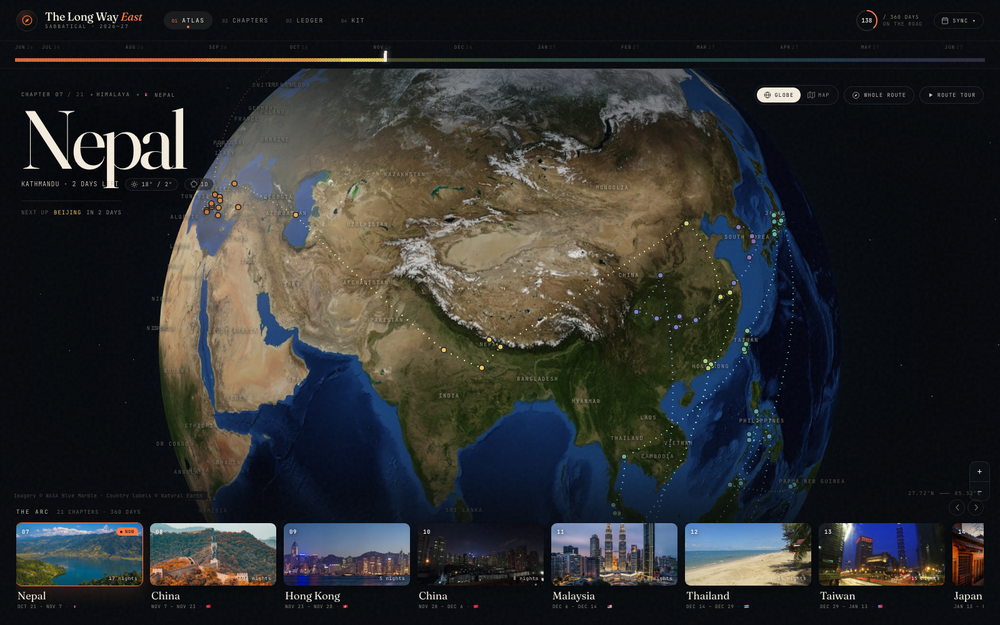

# 🌏 The Long Way East · 2026–2027

*One year. Two travellers. Twenty-one chapters. A carry-on and a backpack each.*



This is the interactive companion to a year-long sabbatical across Asia — part
night atlas, part field journal, part ledger. It holds the whole arc (Brasil →
Canada → Greece → Türkiye → Azerbaijan → India → Nepal → China → Hong Kong →
China → Malaysia → Thailand → Taiwan → Japan → Indonesia → Borneo →
Philippines → Indonesia → Singapore → China → Korea → home), all **360 days**
of it, in one page you can spin, read, budget, and check off.

## The redesign

The old site was a cream editorial binder with a map in the middle. This one
puts the journey on the canvas: a dark, cinematic atlas with the globe as the
hero, a single ember→violet spectrum running through the whole year, and
photography given room to breathe.

- **A cover, not a dashboard.** The first visit opens on a title card — *The
  Long Way East* — then dissolves into the map. One click or two seconds; it
  never gets in the way twice in a session.
- **The year spine.** Every one of the 360 days is a tick, coloured by chapter
  and dimmed once it is behind you. It is a progress bar you can read like a
  calendar, and a jump target for any chapter.
- **A full-bleed atlas.** The 3D globe (or a 2D satellite map) fills the stage.
  Today's chapter is set at 8vw in the corner, with the town you are in, the
  weather, and the next move underneath. The chapter's pins and route arcs are
  painted in its own tint.
- **The chapter reel.** A horizontal film strip of all twenty-one chapters
  rides the bottom edge. It opens where you are, dims the past, and opens any
  chapter into a full editorial spread.
- **Route tour.** Press ▶ and the camera flies chapter to chapter on its own —
  a five-second postcard from every stop. Any click, or Stop, takes the wheel
  back.
- **Chapter spreads.** A full-height sheet with a photo carousel, a giant
  chapter number, the window and weather, a vertical stop timeline, and the
  route decisions in the margin — so future-you remembers *why* Folegandros
  beat Naxos.
- **The ledger.** The budget is now a visual one: a donut of where the money
  goes, a spectrum bar for every chapter, the sortable long table, and a
  receipt that runs from chapters to grand total. Nothing is hardcoded; the
  numbers still compute from the line items.
- **The field kit.** The advance-booking checklist gets a readiness ring, open
  and overdue counts, per-chapter progress, and the same browser ticks and
  export-to-file workflow.
- **Shareable everything.** Every state is a URL
  (`?view=chapters`, `?chapter=japan&place=2`, `?view=ledger`), with the old
  `map` / `budget` / `todo` names kept as aliases.
- **A real mobile layout.** A bottom tab bar, a compact atlas with icon-only
  tools, a swipeable reel, full-screen chapter spreads, and pages built for
  hostel Wi-Fi.

## What's inside

- 🌍 **3D globe + 2D map** — the full route, great-circle arcs, one-tap
  Google Maps links for every stop.
- 📖 **21 chapter spreads** — photos, dates, weather, stops, highlights, and
  route decisions.
- 📊 **A ledger that does math** — per-chapter sortable table, inter-chapter
  flights, locked costs, contingency, per-day and per-person run-rates.
- ✅ **A field kit** — every flight, stay, visa, and permit with book-by dates,
  overdue highlighting, and an export button to commit ticks back to the file.
- 📅 **Google Calendar + Tasks sync** — push chapters, flights, trains, buses,
  ferries, and the checklist to Google.
- 🔗 **Deep links** — the live URL always matches what is on screen.
- 📱 **Mobile-first chrome** — bottom navigation, full-screen sheets, and a
  map that does not fight your thumb.

## Run it

It's a static site. Any static server works:

```bash
# from the project directory
python3 -m http.server 8000
# → http://localhost:8000
```

Internet is needed on first load (React, Leaflet, Three.js, fonts, map tiles
come from CDNs). Everything trip-specific lives in local files.

## PR previews

Every **same-repo** pull request is published to:

```
https://jeitinhovibe.github.io/sabbatical-planning/PR-<number>/
```

The workflow in `.github/workflows/pages.yml` keeps a single `gh-pages`
branch: `main` is the root, and each PR lives in `PR-<number>/`. The preview
is updated on every push to the PR and removed when the PR closes.

**One-time setup (repo admin):** Settings → Pages → Build and deployment →
Source: *Deploy from a branch*, Branch: **`gh-pages`**, Folder: **`/(root)`**.
The workflow creates the branch on its first run (`workflow_dispatch` works
for a manual bootstrap).

Notes:
- **Fork PRs are skipped** — the `pull_request` token can't write to the repo.
- Previews share the `jeitinhovibe.github.io` origin with the main site, so
  `localStorage` (todo ticks, cached trip data, sync IDs) is shared. Use a
  private window when testing a preview.
- Assets are relative, so the site needs no base-path configuration.

## Editing the trip

`itinerary-data.js` is the **single source of truth** — chapters, budget,
flights, bookings, packing. Everything on screen derives from it.

```bash
./build.sh                             # re-compile *.jsx → dist/ after editing components
node scripts/validate-photo-urls.mjs   # check photo keywords resolve
```

Install the pre-commit hook to run the photo check automatically:

```bash
bash scripts/install-pre-commit-hook.sh
```

Practical notes:

- Chapter numbers are **never stored** — `itinerary-store.js` derives them from
  array order, so reordering chapters is renumber-free.
- The chapter colour is **derived**, not authored: `shared.jsx` maps each
  chapter's position in the arc onto a 21-step ember→violet spectrum. Change
  the spectrum there, not in `itinerary-data.js`.
- Todo ticks in the UI live in the browser; use the page's **Export** button to
  copy states back into `todo-data.js` (the durable record) and commit them.
- `calendar-config.js` (gitignored, Google OAuth client ID) is optional — copy
  `calendar-config.example.js` to create it.

## Project structure

| File | What it is |
|---|---|
| `index.html` | Shell — fonts, CDNs, data, compiled app |
| `itinerary-data.js` | 🧠 The trip itself: chapters, budget, flights, bookings |
| `itinerary-geo.js` | Map coordinates per chapter/stop |
| `itinerary-photos.js` | Photo keyword → local `extra-pictures/` mapping |
| `itinerary-store.js` | Read-only view over the data (+ localStorage cache) |
| `app.jsx` | Cover, chrome, year spine, atlas stage, chapter reel, tour, deep links |
| `shared.jsx` | Photo, icons, now/next math, the journey spectrum |
| `map-view.jsx` / `globe-view.jsx` | 2D Leaflet map / 3D Three.js globe |
| `panels.jsx` | Chapter grid, chapter spread, ledger |
| `calendar.jsx` | Google Calendar sync (`SyncButton` dropdown) |
| `tasks.jsx` | Google Tasks sync (checklist → "Sabbatical" list) |
| `todo.jsx` / `todo-data.js` | Field kit view / its data |
| `styles.css` | The whole night-atlas visual system |
| `extra-pictures/` | All photography, stored locally |
| `dist/` | Pre-compiled JS (checked in so static hosting just works) |
| `reviews/` | Past itinerary review reports (local-only, gitignored) |
| `screenshot.png` | The screenshot up top ☝️ |

## Tech

React 18 (UMD, no bundler in the browser) · Leaflet · Three.js · Babel
pre-compilation via `build.sh` · zero backend — it's a page, not a platform.

---

*Built for two Brazilians with carry-ons, backpacks, and strong opinions about sunsets.*
*If you're reading this from a night train somewhere in Asia: it worked.* 🚂
